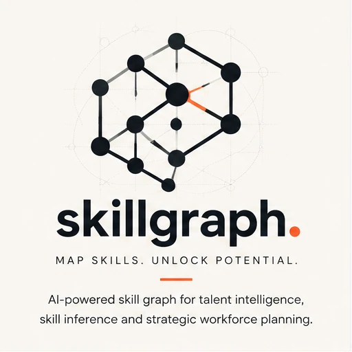
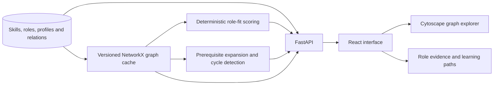

<p align="center"></p>

# SkillGraph

**Explore a skill ontology, explain role fit, and build learning paths from visible gaps.**

[](https://github.com/hasanhuseyinyetkiner/skillgraph/actions/workflows/ci.yml)
[](LICENSE)

[Highlights](#highlights) · [Architecture](#architecture) · [Scoring](#scoring-and-paths) · [Evaluation](#evaluation) · [Quick start](#quick-start) · [Documentation](#documentation)

<p align="center">
  <picture>
    <source media="(prefers-color-scheme: dark)" srcset="docs/screenshots/graph-explorer-dark.png">
    
  </picture>
</p>

The Graph Explorer renders the seeded ontology with Cytoscape. Explore a category and select a node to inspect its relations; then review a [role fit](docs/screenshots/role-explorer-light.png) or [learning path](docs/screenshots/path-builder-light.png).

[Watch the real graph → role fit → learning path workflow (GIF)](docs/assets/demo.gif). The screenshot above is a static alternative; regenerate the animation with `node scripts/record-demo.mjs` after installing the project dependencies, Playwright Chromium and FFmpeg. The isolated synthetic data and recording are retained in a temporary folder.

> Local, single-user MVP using synthetic profiles. The fit index is exploratory coverage, not a hiring probability or an employment decision.

## Highlights

- **A visible ontology.** Explore skills, aliases and typed relations in a graph with an adjacency inspector.
- **Explainable role fit.** Exact, validated synonym and related-skill matches contribute named evidence; gaps and mandatory requirements remain visible.
- **Cycle-aware learning paths.** Prerequisite expansion finds a feasible order when possible and reports cycles instead of inventing one.
- **Deterministic by default.** The demo and evaluation do not require embeddings or a model download; optional semantic similarity has zero composite weight.
- **Inspectable evaluation.** Compare the graph-augmented ranker with an overlap baseline on hand-labeled synthetic fixtures.

## Architecture



SQLAlchemy persists the ontology and profiles in SQLite locally or PostgreSQL in CI. The in-memory NetworkX snapshot reloads when `graph_version` changes. FastAPI exposes graph, recommendation and path results to the React interface; recommendation traces retain the graph version. See the [algorithm documentation](docs/ALGORITHM.md).

## Scoring and paths

Aliases are normalized and checked for collisions. An exact canonical match receives `1.0 × level factor`; a validated synonym receives `0.95 × level factor`. Related skills may earn partial credit but **never satisfy a mandatory requirement**. The mandatory gate is separate from the fit index. Path construction expands prerequisites and detects strongly connected components; affected skills are not assigned a fabricated order when a cycle is present. Full weights, relation types and edge cases are in [the algorithm reference](docs/ALGORITHM.md).

## Evaluation

The [evaluation](docs/EVALUATION.md) reports precision, recall and nDCG at 3 and 5 for ten hand-labeled synthetic profiles (`gold-fixtures-1.1.0`), measured on 2026-10-21 with embeddings disabled. Candidate roles are limited to each fixture's labeled set.

| Method | P@3 | R@3 | nDCG@3 | nDCG@5 |
| --- | ---: | ---: | ---: | ---: |
| Overlap baseline | 0.8667 | 0.5175 | 0.8152 | 0.8908 |
| Graph-augmented | 0.9000 | 0.6175 | 0.9383 | 0.9684 |

P@5 and R@5 tied on this fixture set, and seven fixtures retained identical top-3 and top-5 grade sequences. These small, synthetic judgments do not establish hiring outcomes or generalization. The [evaluation report](docs/EVALUATION.md) includes the full table, tie analysis and methodology; [performance measurements](docs/PERFORMANCE_BASELINE.md) describe their local workload and limits.

## Quick start

Requires Python 3.12+, [uv](https://docs.astral.sh/uv/), Node.js and pnpm. From the repository root, start the API:

```powershell
cd backend
uv sync
uv run python -m app
```

In a second terminal, from the repository root:

```powershell
cd frontend
pnpm install
pnpm dev
```

Open [the app](http://127.0.0.1:5105) or [API documentation](http://127.0.0.1:8105/docs). The seeded demo includes the synthetic profile Avery Chen. Try **Graph Explorer → Role Explorer → Analytics Engineer → Compute role fit → Path Builder**. The default database is `backend/data/skillgraph.db`; configuration is documented in [`.env.example`](.env.example) and [`frontend/.env.example`](frontend/.env.example). Prefer one local API process with SQLite.

The native path was previously verified on Windows. Local Docker Compose was unavailable on the authoring host; the [CI workflow](.github/workflows/ci.yml) defines a Compose smoke job.

## Tests

Stop the quick-start API and frontend before running Playwright: its test configuration starts an isolated stack on the same ports and does not reuse existing servers. From the repository root:

```powershell
cd backend
uv run ruff check .
uv run pytest -q
cd ../frontend
pnpm lint
pnpm test
pnpm build
pnpm exec playwright install chromium  # once
pnpm e2e
```

CI defines link, backend, frontend, Playwright and Compose checks in [its workflow](.github/workflows/ci.yml). A previous local report dated 2026-10-21 recorded 47 backend tests passed and one PostgreSQL test skipped. These are historical results, not a claim about the current run. The Playwright journey covers the demo profile, graph, role fit and learning path.

## Security and limitations

Use synthetic profiles only. This MVP has no multi-user authentication and binds to loopback by default; non-loopback binding requires `ALLOW_NETWORK_BIND=true`. It is not a public multi-tenant service and is not designed to make promotion or rejection decisions. The seed is synthetic; no external taxonomy is claimed. See [security](SECURITY.md) and the limitations in the [algorithm](docs/ALGORITHM.md) and [evaluation](docs/EVALUATION.md) references.

## Documentation

- [Scoring, ontology and path algorithms](docs/ALGORITHM.md)
- [Evaluation and fixture methodology](docs/EVALUATION.md)
- [Local performance baseline](docs/PERFORMANCE_BASELINE.md)
- [Security](SECURITY.md), [frontend setup](frontend/README.md) and [MIT license](LICENSE)
