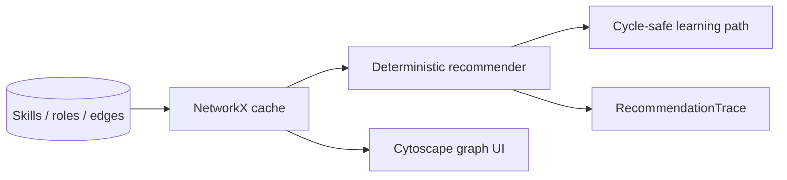

<a id="readme-top"></a>

<div align="center">

<picture>
  <source media="(prefers-color-scheme: dark)" srcset="docs/assets/banner-dark.svg">
  
</picture>

# SkillGraph

**Map what you know. Discover where your skills can take you.**

Explainable skill graphs, career transition paths, and learning gap analysis — deterministic baseline, embeddings optional.

[Quick start](#quick-start) · [How it works](#how-it-works) · [Evaluation](#evaluation) · [API](#api) · [Limitations](#security-privacy-and-limitations)

</div>

## Why it exists

Internal career mobility tools often score people with opaque models. SkillGraph keeps the ontology, match types, and score components inspectable: aliases, related skills, mandatory gates, and cycle-safe learning paths on a synthetic demo catalog.

## Capabilities

| Shipped | Notes |
| --- | --- |
| Skills inventory + demo profile | Export / erase / reset |
| Ontology aliases & relations | Prerequisite, related, broader/narrower |
| Graph Explorer | Cytoscape.js on live `GET /api/graph` |
| Role Explorer | Named score components + role compare + gap chart |
| Path Builder | Cycle-safe prerequisite ordering + resources |
| Methodology + evaluation | Precision / Recall / nDCG on gold fixtures |
| Versioned graph cache | `graph_version` shared across workers |

Embeddings (`sentence-transformers`) are an optional extra and are **off** by default.

## Quick start

Native path (verified on Windows 11 with `uv` + `pnpm`). Docker Compose is also exercised by the green `compose-smoke` CI job. Prefer one local API process against the default SQLite file — a second start will fail after a short lock timeout instead of hanging.

```powershell
# Backend — http://127.0.0.1:8105
cd backend
uv sync
uv run python -m app

# Frontend — http://127.0.0.1:5105 (new terminal)
cd frontend
pnpm install
pnpm dev
```

| Service | URL |
| --- | --- |
| Web | http://127.0.0.1:5105 |
| API docs | http://127.0.0.1:8105/docs |
| Health | http://127.0.0.1:8105/health |

Seed loads ≥80 skills, ≥20 roles, ≥30 learning resources. Open **Graph Explorer** → **Role Explorer** → **Path Builder**.

Copy `.env.example` / `frontend/.env.example` only if you need overrides. Default DB is SQLite at `backend/data/skillgraph.db`.

## How it works



`graph_version` increments with every ontology edit so workers reload consistently. See [docs/ALGORITHM.md](docs/ALGORITHM.md).

## Evaluation

Measured on five hand-labeled synthetic profiles (`GET /api/evaluation`). Grades are fixture judgments, not hiring outcomes.

| Method | P@3 | P@5 | R@3 | R@5 | nDCG@3 | nDCG@5 |
| --- | ---: | ---: | ---: | ---: | ---: | ---: |
| Overlap baseline | 1.0000 | 0.9600 | 0.5450 | 0.8583 | 0.9860 | 0.9754 |
| Graph-augmented | 1.0000 | 0.9600 | 0.5450 | 0.8583 | 0.9860 | 0.9754 |

Macro averages can tie while per-role scores differ: on the `synonym_specialist` fixture, graph coverage for **Backend Engineer** exceeds the overlap baseline because `Postgres`/`js` aliases resolve to identity matches.

## API

```powershell
curl http://127.0.0.1:8105/ready
curl http://127.0.0.1:8105/api/profiles/demo
curl -X POST http://127.0.0.1:8105/api/recommendations -H "Content-Type: application/json" -d "{\"profile_id\":1,\"role_id\":1}"
curl -X POST http://127.0.0.1:8105/api/learning-paths -H "Content-Type: application/json" -d "{\"profile_id\":1,\"role_id\":1}"
curl http://127.0.0.1:8105/api/evaluation
```

Key routes: `/api/skills`, `/api/graph`, `/api/roles`, `/api/profiles/*`, `/api/recommendations`, `/api/recommendations/compare`, `/api/learning-paths`, `/api/ontology/quality`, `/api/evaluation`, `/health`, `/ready`.

## Testing

```powershell
cd backend
uv run ruff check .
uv run pytest -q

cd ../frontend
pnpm lint
pnpm test
pnpm build
pnpm exec playwright install chromium   # once
pnpm e2e
```

Latest local verification (2026-10-20, anti-slop re-audit): backend **32 passed, 1 skipped** (postgres marker); frontend Vitest **1 passed**; `pnpm build` OK. Live API on `:8105`: demo profile, named score components (`exact_match` / `validated_synonym` / `related_skill` / …), learning path cycle reporting on Legacy Integration Engineer, `graph_version` increments on ontology edits. Playwright covers demo → graph → role fit → path.

## Compose / CI

`compose.yaml` binds API `127.0.0.1:8105`, web `127.0.0.1:5105`, Postgres host `5405`. GitHub Actions runs Ruff + pytest (Postgres service), frontend lint/tsc/vitest/build, and `compose-smoke` (verified green on `main`). Local Docker is not required for development.

## Security, privacy and limitations

> [!IMPORTANT]
> Synthetic profiles only. Recommendations are exploratory — never a probability of getting a job, a promotion decision, or a person score. No protected attributes are used.

- Loopback bind by default (`ALLOW_NETWORK_BIND=true` required otherwise).
- No multi-user auth in this MVP.
- External taxonomies are not claimed; seed data is synthetic/attributed in-code.

License: pending owner decision.

Docs: [ALGORITHM.md](docs/ALGORITHM.md) · [GITHUB_METADATA.md](docs/GITHUB_METADATA.md) · [PRODUCT_SPEC.md](docs/PRODUCT_SPEC.md) · [REVIEW_AMENDMENTS.md](docs/REVIEW_AMENDMENTS.md)

<p align="right"><a href="#readme-top">↑ back to top</a></p>
