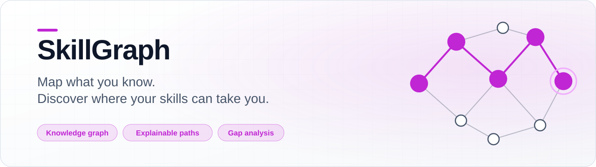
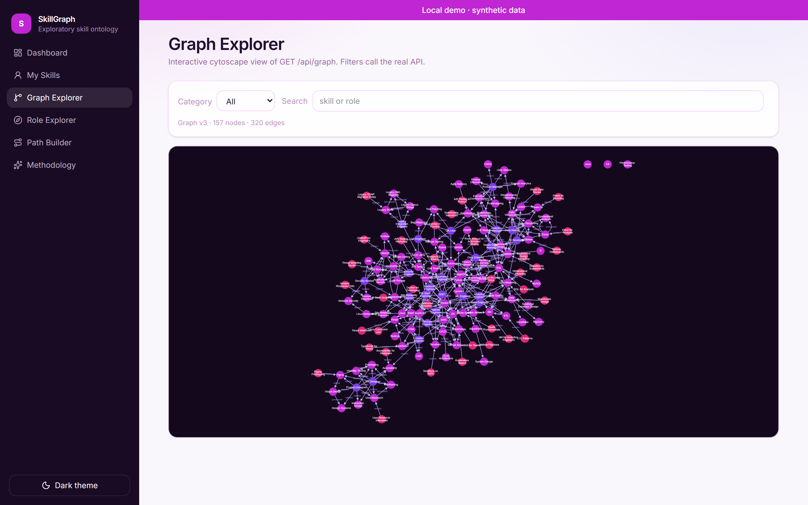
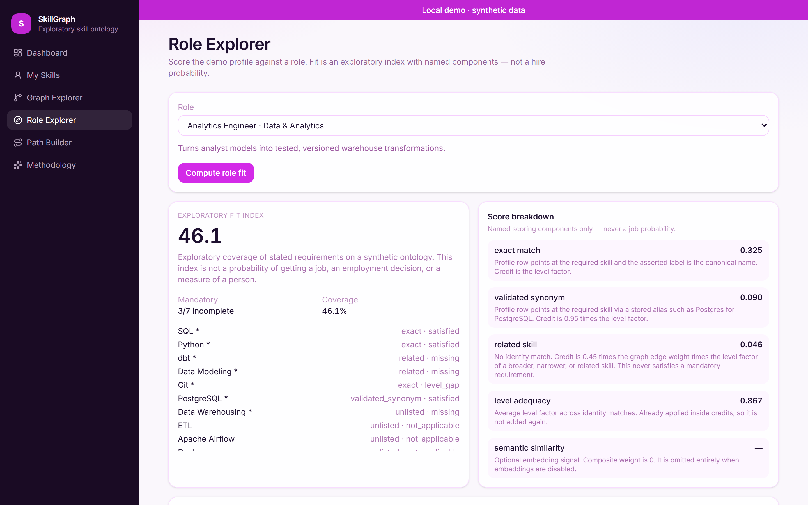
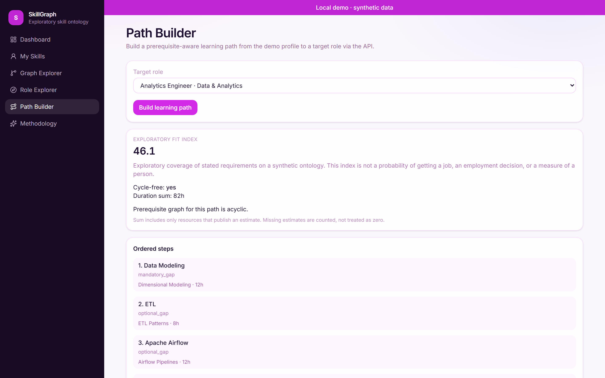

<a id="readme-top"></a>

<div align="center">

<picture>
  <source media="(prefers-color-scheme: dark)" srcset="docs/assets/banner-dark.svg">
  
</picture>

# SkillGraph

**Map what you know. Discover where your skills can take you.**

Explainable skill ontology, role-fit scoring with named match types, and cycle-safe learning paths — deterministic by default, embeddings optional. Accent `#C026D3`.

[](https://github.com/hasanhuseyinyetkiner/skillgraph/actions/workflows/ci.yml)

[Overview](#executive-overview) · [Demo](#product-demonstration) · [Architecture](#system-architecture) · [Algorithm](#how-scoring-and-paths-work) · [Evaluation](#evaluation-and-evidence) · [Quick start](#getting-started) · [Docs](#documentation)

</div>

<p align="center">
  <picture>
    <source media="(prefers-color-scheme: dark)" srcset="docs/screenshots/graph-explorer-dark.png">
    
  </picture>
</p>

---

## Executive overview

| Dimension | Description |
| --- | --- |
| Business challenge | Internal mobility tools hide the ontology and the score, so reviewers cannot see *why* a role ranked where it did. |
| Proposed solution | Explainable skill graph: aliases, role-fit with named match types, cycle-safe learning paths — deterministic by default, embeddings optional. |
| Primary users | Staff engineers reviewing knowledge-graph design; HR-tech reviewers evaluating explainable career-path recommenders. |
| Engineering challenge | Alias identity vs related credit; mandatory gates that related edges cannot satisfy; cycle-safe path ordering; honest eval when macro metrics tie. |
| Architecture | FastAPI + NetworkX cache (`graph_version`) · React + Cytoscape · SQLite local / Postgres CI · accent `#C026D3` |
| Validation | 32 pytest; Vitest; Playwright demo arc; P@k / nDCG@k on five hand-labeled fixtures (macro graph tie documented) |
| Project status | Local **MVP / demo**. Fit index ≠ hiring probability. License pending. |

## Product demonstration

Screenshots captured 2026-10-20 via Playwright against live API `8105` + Vite `5105` (`pnpm screenshots`).

| View | Light | Dark |
| --- | --- | --- |
| Graph Explorer | [graph-explorer-light.png](docs/screenshots/graph-explorer-light.png) | [graph-explorer-dark.png](docs/screenshots/graph-explorer-dark.png) |
| Role Explorer | [role-explorer-light.png](docs/screenshots/role-explorer-light.png) | [role-explorer-dark.png](docs/screenshots/role-explorer-dark.png) |
| Path Builder | [path-builder-light.png](docs/screenshots/path-builder-light.png) | [path-builder-dark.png](docs/screenshots/path-builder-dark.png) |

<p align="center">
  <picture>
    <source media="(prefers-color-scheme: dark)" srcset="docs/screenshots/role-explorer-dark.png">
    
  </picture>
</p>

## Capabilities

| Area | Status | Notes |
| --- | --- | --- |
| Skills inventory | Shipped | Demo profile (Avery Chen); export / erase / reset |
| Ontology | Shipped | Aliases, prerequisite / related / broader / narrower |
| Graph Explorer | Shipped | Cytoscape.js on live `GET /api/graph` |
| Role Explorer | Shipped | Named components, role compare, match-type chart |
| Path Builder | Shipped | Cycle-safe prerequisite order + learning resources |
| Evaluation | Shipped | P@k / R@k / nDCG@k on five hand-labeled fixtures |
| Versioned cache | Shipped | `graph_version` across API workers |
| Embeddings | Optional extra | Off by default; composite weight `0` when present |
| Multi-user auth | Not shipped | Loopback demo only |

Seed (verified on local SQLite): **97** skills, **24** roles, **36** learning resources, **103** relations.

## System architecture

```mermaid
%%{init: {
  "theme": "base",
  "themeVariables": {
    "primaryColor": "#C026D3",
    "primaryTextColor": "#ffffff",
    "primaryBorderColor": "#86198F",
    "lineColor": "#C026D3",
    "secondaryColor": "#FAE8FF",
    "tertiaryColor": "#FDF4FF",
    "fontFamily": "ui-sans-serif, system-ui, sans-serif"
  }
}}%%
flowchart LR
  PG[(Skills / roles / edges)] --> META[graph_version]
  META --> NX[NetworkX cache]
  NX --> R[Deterministic recommender]
  R --> P[Cycle-safe learning path]
  NX --> UI[Cytoscape graph UI]
  R --> T[RecommendationTrace]
  R --> EVAL[P@k / nDCG@k fixtures]
```

| Layer | Choice | Why |
| --- | --- | --- |
| API | FastAPI + SQLAlchemy 2 + Alembic | Typed DTOs, migrations, `/health` + `/ready` |
| Graph | NetworkX snapshot keyed by `graph_version` | Reload on ontology edits without Neo4j |
| Scoring | Pure Python domain module | Unit-testable; embeddings never required |
| UI | React + Vite + Cytoscape + Recharts | Interactive graph + named gap chart |
| Data | SQLite local / Postgres in CI | Same models; compose verified in `compose-smoke` |

Deep dive: [docs/ALGORITHM.md](docs/ALGORITHM.md) · [docs/ENGINEERING_DECISIONS.md](docs/ENGINEERING_DECISIONS.md).

## Getting started

Native path verified on Windows 11 with `uv` + `pnpm`. Docker Compose is exercised by the green `compose-smoke` CI job — local Docker is not required.

```powershell
# Backend — http://127.0.0.1:8105
cd backend
uv sync
uv run python -m app

# Frontend — http://127.0.0.1:5105 (new terminal)
cd frontend
pnpm install
pnpm dev
```

| Service | URL |
| --- | --- |
| Web | http://127.0.0.1:5105 |
| API docs | http://127.0.0.1:8105/docs |
| Health | http://127.0.0.1:8105/health |
| Ready | http://127.0.0.1:8105/ready |

Default DB: `backend/data/skillgraph.db`. Overrides: [`.env.example`](.env.example) / [`frontend/.env.example`](frontend/.env.example). Prefer one local API process against the default SQLite file.

## 60-second demo

1. Open http://127.0.0.1:5105 — demo banner + profile **Avery Chen**.
2. **Graph Explorer** — Cytoscape canvas; note `Graph vN · … nodes · … edges`.
3. **Role Explorer** → **Analytics Engineer** → **Compute role fit** — named components (`exact_match`, `validated_synonym`, `related_skill`, …). Label is an exploratory fit index, **not** a hiring probability.
4. **Path Builder** → same role → **Build path** — ordered gap steps when cycle-free; cycles are reported, not invented away.

<p align="center">
  <picture>
    <source media="(prefers-color-scheme: dark)" srcset="docs/screenshots/path-builder-dark.png">
    
  </picture>
</p>

Playwright covers the same arc: `demo profile → graph → role fit → learning path` (`frontend/e2e/demo-flow.spec.ts`).

## How scoring and paths work

**Alias normalization.** Labels fold to a collision-checked token (`Postgres` → `postgres`). Identity via alias is `validated_synonym` (0.95× level factor), not exact (1.0).

**Mandatory gates.** Related / semantic credit **never** satisfies a mandatory requirement. The gate is reported separately from the fit index.

**Cycle-safe paths.** Prerequisite expansion + SCC detection. If a cycle touches the path, `cycle_free=false` and those skills get no invented order.

**`graph_version`.** Incremented in the same transaction as ontology edits; NetworkX reloads when the version changes; every recommendation and trace records it.

Full rules: [docs/ALGORITHM.md](docs/ALGORITHM.md).

## Evaluation and evidence

Measured via `GET /api/evaluation` on five hand-labeled synthetic profiles (`method_version=skg-baseline-1.0.0`). Grades are fixture judgments on the demo ontology — **not** hiring outcomes, **not** job-offer probabilities.

| Method | P@3 | P@5 | R@3 | R@5 | nDCG@3 | nDCG@5 |
| --- | ---: | ---: | ---: | ---: | ---: | ---: |
| Overlap baseline | 1.0000 | 0.9600 | 0.5450 | 0.8583 | 0.9860 | 0.9754 |
| Graph-augmented | 1.0000 | 0.9600 | 0.5450 | 0.8583 | 0.9860 | 0.9754 |

**Honest read:** macro ranking metrics **tie** — not a hidden win for the graph. Top-k *relevance-grade* sequences match on every fixture, so P@k / R@k / nDCG@k cannot move. Overlap is canonical-name equality only (no aliases); graph resolves aliases and weak related credit. Per-role *coverage* still differs (e.g. `synonym_specialist` → Backend Engineer: graph **0.546** vs overlap **0.143**) without flipping top-k grades. Related-edge ranking gains are **unproven** on this set. Full analysis: [docs/EVALUATION.md](docs/EVALUATION.md).

## API

```powershell
curl http://127.0.0.1:8105/ready
curl http://127.0.0.1:8105/api/profiles/demo
curl -X POST http://127.0.0.1:8105/api/recommendations -H "Content-Type: application/json" -d "{\"profile_id\":1,\"role_id\":1}"
curl -X POST http://127.0.0.1:8105/api/learning-paths -H "Content-Type: application/json" -d "{\"profile_id\":1,\"role_id\":1}"
curl http://127.0.0.1:8105/api/evaluation
```

Key routes: `/api/skills`, `/api/graph`, `/api/roles`, `/api/profiles/*`, `/api/recommendations`, `/api/recommendations/compare`, `/api/learning-paths`, `/api/ontology/quality`, `/api/evaluation`, `/health`, `/ready`.

## Testing

```powershell
cd backend
uv run ruff check .
uv run pytest -q

cd ../frontend
pnpm lint
pnpm test
pnpm build
pnpm exec playwright install chromium   # once
pnpm e2e
pnpm screenshots   # writes docs/screenshots/*.png
```

| Check | Result (2026-10-20) |
| --- | --- |
| `uv run pytest -q` | **32 passed**, 1 skipped (Postgres marker) |
| `pnpm test` (Vitest) | **1 passed** |
| Eval metrics | Live `GET /api/evaluation` (table above) |
| Playwright screenshots | 6 PNGs (graph / role / path × light+dark) |

`compose.yaml` binds API `127.0.0.1:8105`, web `127.0.0.1:5105`, Postgres host `5405`. CI runs Ruff + pytest (Postgres service), frontend lint/tsc/vitest/build, and `compose-smoke`.

## Engineering competencies demonstrated

| Competency | Evidence |
| --- | --- |
| Graph / ontology design | NetworkX cache, aliases, relation types, `graph_version` — [`docs/ALGORITHM.md`](docs/ALGORITHM.md) |
| Explainable scoring | Named match components; mandatory gates unrelated to soft credit |
| Correctness under cycles | SCC detection; refuse invented path order when cyclic |
| Honest evaluation | Macro P@k/nDCG tie reported; per-role coverage deltas documented |
| Product engineering | Cytoscape explorer, Playwright demo arc, erase/reset privacy controls |

## Security, privacy, and limitations

> [!IMPORTANT]
> Synthetic profiles only. Fit scores are exploratory — never a probability of getting a job, a promotion decision, or a person score. No protected attributes are used.

- Loopback bind by default (`ALLOW_NETWORK_BIND=true` required otherwise).
- No multi-user auth in this MVP.
- External taxonomies are not claimed; seed data is synthetic/attributed in-code.
- Embeddings optional; demo and evaluation run with `EMBEDDINGS_ENABLED=false`.
- Macro metrics can tie even when per-role coverage changes — see [docs/EVALUATION.md](docs/EVALUATION.md).

License: pending owner decision.

## Documentation

| Doc | Contents |
| --- | --- |
| [`docs/ALGORITHM.md`](docs/ALGORITHM.md) | Normalization, edge types, credits, gates, paths, worked examples |
| [`docs/EVALUATION.md`](docs/EVALUATION.md) | Macro tie, error analysis, coverage cases, unproven claims |
| [`docs/ENGINEERING_DECISIONS.md`](docs/ENGINEERING_DECISIONS.md) | Cache versioning, embeddings optional, eval honesty |
| [`docs/RELEASE_READINESS.md`](docs/RELEASE_READINESS.md) | Pre-tag checklist (local / portfolio) |
| [`docs/GITHUB_METADATA.md`](docs/GITHUB_METADATA.md) | About text and topics |
| [`frontend/README.md`](frontend/README.md) | Frontend setup, scripts, pages |
| [`docs/PRODUCT_SPEC.md`](docs/PRODUCT_SPEC.md) | Historical product brief (not live contract) |

<p align="right"><a href="#readme-top">↑ back to top</a></p>
