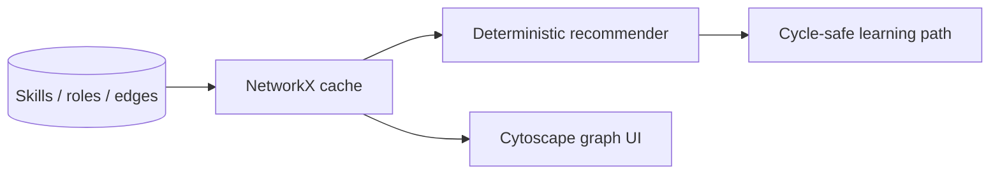

<a id="readme-top"></a>

<div align="center">

<picture>
  <source media="(prefers-color-scheme: dark)" srcset="docs/assets/banner-dark.svg">
  
</picture>

**Explainable skill graphs and career paths.** Browse a seeded ontology, inspect role fit with named score components, and build cycle-safe learning paths — embeddings optional.

[Quick start](#quick-start) · [How it works](#how-it-works) · [Limitations](#security-privacy-and-limitations)

</div>

## Quick start

```powershell
# Backend (API http://127.0.0.1:8105)
cd backend
uv sync
uv run python -m app

# Frontend (http://127.0.0.1:5105) — new terminal
cd frontend
pnpm install
pnpm dev
```

| Service | URL |
| --- | --- |
| Web | http://127.0.0.1:5105 |
| API docs | http://127.0.0.1:8105/docs |

Seed loads ≥80 skills, ≥20 roles and learning resources. Open Graph Explorer → pick a target role → Path Builder.

## How it works



`graph_version` increments with ontology edits so workers stay consistent.

## Testing

```powershell
cd backend; uv run pytest -q
cd frontend; pnpm build
```

## Security, privacy and limitations

> [!IMPORTANT]
> Synthetic profiles. Recommendations are exploratory — never a probability of getting a job. No automated promotion or rejection.

License: pending owner decision.

<p align="right"><a href="#readme-top">↑ back to top</a></p>
