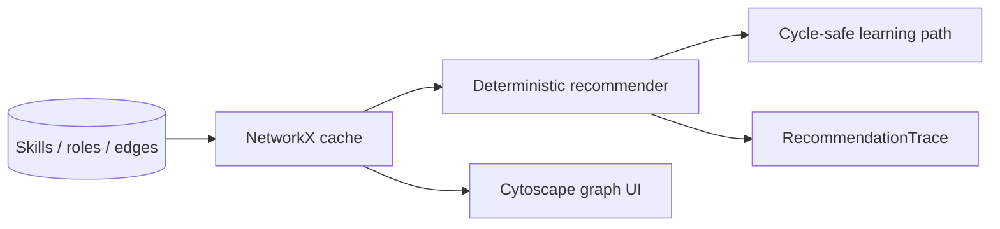

<a id="readme-top"></a>

<div align="center">

<picture>
  <source media="(prefers-color-scheme: dark)" srcset="docs/assets/banner-dark.svg">
  
</picture>

# SkillGraph

**Map what you know. Discover where your skills can take you.**

Explainable skill ontology, role-fit scoring with named match types, and cycle-safe learning paths — deterministic by default, embeddings optional. Accent `#C026D3`.

[](https://github.com/hasanhuseyinyetkiner/skillgraph/actions/workflows/ci.yml)

[Quick start](#quick-start) · [60-second demo](#60-second-demo) · [How it works](#how-it-works) · [Evaluation](#evaluation) · [Testing](#testing) · [Limitations](#security-privacy-and-limitations)

</div>

## Why it exists

Internal mobility tools often hide the graph and the score. SkillGraph keeps aliases, relation types, mandatory gates, and path ordering inspectable on a synthetic catalog — so you can see *why* a role ranked where it did.

## Features

| Area | Shipped |
| --- | --- |
| Skills inventory | Demo profile (Avery Chen), export / erase / reset |
| Ontology | Aliases, prerequisite / related / broader / narrower |
| Graph Explorer | Cytoscape.js on live `GET /api/graph` |
| Role Explorer | Named score components, role compare, gap chart |
| Path Builder | Cycle-safe prerequisite order + learning resources |
| Evaluation | P@k / R@k / nDCG@k on five hand-labeled synthetic fixtures |
| Ops | Versioned NetworkX cache (`graph_version` across workers) |

Embeddings (`sentence-transformers`) are an optional extra and are **off** by default.

## Quick start

Native path verified on Windows 11 with `uv` + `pnpm`. Docker Compose is exercised by the green `compose-smoke` CI job. Prefer one local API process against the default SQLite file — a second start fails after a short lock timeout instead of hanging.

```powershell
# Backend — http://127.0.0.1:8105
cd backend
uv sync
uv run python -m app

# Frontend — http://127.0.0.1:5105 (new terminal)
cd frontend
pnpm install
pnpm dev
```

| Service | URL |
| --- | --- |
| Web | http://127.0.0.1:5105 |
| API docs | http://127.0.0.1:8105/docs |
| Health | http://127.0.0.1:8105/health |

Seed loads ≥80 skills, ≥20 roles, ≥30 learning resources. Default DB: `backend/data/skillgraph.db`. Copy [`.env.example`](.env.example) / [`frontend/.env.example`](frontend/.env.example) only for overrides.

## 60-second demo

1. Open http://127.0.0.1:5105 — demo banner + profile **Avery Chen**.
2. **Graph Explorer** — Cytoscape canvas, `Graph vN` from the live ontology.
3. **Role Explorer** → pick a role → **Compute fit** — named components (`exact_match`, `validated_synonym`, `related_skill`, …); label is an exploratory fit index, not a hiring probability.
4. **Path Builder** → same role → **Build path** — ordered gap steps when cycle-free; cycles are reported, not invented away.

Playwright covers the same arc: `demo profile → graph → role fit → learning path` (`frontend/e2e/demo-flow.spec.ts`).

## How it works



`graph_version` increments with every ontology edit so workers reload consistently. Scoring and path rules: [docs/ALGORITHM.md](docs/ALGORITHM.md).

## Evaluation

Measured via `GET /api/evaluation` on five hand-labeled synthetic profiles. Grades are fixture judgments on the demo ontology — not hiring outcomes, not job-offer probabilities.

| Method | P@3 | P@5 | R@3 | R@5 | nDCG@3 | nDCG@5 |
| --- | ---: | ---: | ---: | ---: | ---: | ---: |
| Overlap baseline | 1.0000 | 0.9600 | 0.5450 | 0.8583 | 0.9860 | 0.9754 |
| Graph-augmented | 1.0000 | 0.9600 | 0.5450 | 0.8583 | 0.9860 | 0.9754 |

Macro averages can tie while per-role scores differ: on the `synonym_specialist` fixture, graph coverage for **Backend Engineer** exceeds the overlap baseline because `Postgres` / `js` aliases resolve to identity matches.

## API

```powershell
curl http://127.0.0.1:8105/ready
curl http://127.0.0.1:8105/api/profiles/demo
curl -X POST http://127.0.0.1:8105/api/recommendations -H "Content-Type: application/json" -d "{\"profile_id\":1,\"role_id\":1}"
curl -X POST http://127.0.0.1:8105/api/learning-paths -H "Content-Type: application/json" -d "{\"profile_id\":1,\"role_id\":1}"
curl http://127.0.0.1:8105/api/evaluation
```

Key routes: `/api/skills`, `/api/graph`, `/api/roles`, `/api/profiles/*`, `/api/recommendations`, `/api/recommendations/compare`, `/api/learning-paths`, `/api/ontology/quality`, `/api/evaluation`, `/health`, `/ready`.

## Testing

```powershell
cd backend
uv run ruff check .
uv run pytest -q

cd ../frontend
pnpm lint
pnpm test
pnpm build
pnpm exec playwright install chromium   # once
pnpm e2e
```

| Check | Result (2026-10-20) |
| --- | --- |
| `uv run pytest -q` | **32 passed**, 1 skipped (Postgres marker) |
| `pnpm test` (Vitest) | **1 passed** |
| Eval metrics | Re-printed from `test_evaluation_reports_measured_metrics` (table above) |
| Playwright | demo → graph → role fit → path |

`compose.yaml` binds API `127.0.0.1:8105`, web `127.0.0.1:5105`, Postgres host `5405`. CI runs Ruff + pytest (Postgres service), frontend lint/tsc/vitest/build, and `compose-smoke`.

## Security, privacy and limitations

> [!IMPORTANT]
> Synthetic profiles only. Fit scores are exploratory — never a probability of getting a job, a promotion decision, or a person score. No protected attributes are used.

- Loopback bind by default (`ALLOW_NETWORK_BIND=true` required otherwise).
- No multi-user auth in this MVP.
- External taxonomies are not claimed; seed data is synthetic/attributed in-code.

License: pending owner decision.

Docs: [ALGORITHM.md](docs/ALGORITHM.md) · [GITHUB_METADATA.md](docs/GITHUB_METADATA.md) · [PRODUCT_SPEC.md](docs/PRODUCT_SPEC.md) · [REVIEW_AMENDMENTS.md](docs/REVIEW_AMENDMENTS.md)

<p align="right"><a href="#readme-top">↑ back to top</a></p>
